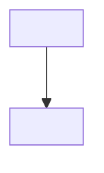

# Notes format

## Where notes live

Get `vaultPath` and `baseFolder` from the **learn** skill's config script. Topic folder:

```
<vaultPath>/<baseFolder>/<Topic>/      (or ./learning/<Topic>/ when vaultPath is unset)
├── <Topic>.md            topic index (one per topic)
├── _learner.md           learner state (owned by the learn skill)
├── RESOURCES.md          sources list
├── ROADMAP.md            only if curate made one
├── Glossary.md           terms in plain words
├── concepts/             one idea per note
├── sources/              one note per article, paper, or video (plus raw copies)
└── sessions/             YYYY-MM-DD <title>.md
```

If no vault is set and the user wants notes, ask once for the vault path and save it with `config.mjs set vaultPath <path>`.

## Writing files

- Write the files directly. That works with Obsidian closed.
- If the **obsidian-markdown** skill (obsidian-skills) is available, follow it for wikilinks, callouts, embeds, and properties. Otherwise use the syntax below, which is plain Obsidian markdown.
- Use **obsidian-cli** only when the Obsidian app is running and you need something files can't do, such as vault-wide search across other folders or opening a note for the user.
- Note names: plain titles in Title Case, no dates except in `sessions/`. Link with `[[Note Name]]`.

## Writing rules

Follow the learning profile (see **learning-profile**) for note preferences such as length, language, or more diagrams. They override the rules below where they conflict, except citing sources.

- **Distill, don't dump.** Never paste chat replies or transcripts into a note. Write the idea in the fewest clear words, following **plain-explain**.
- **Stand alone.** Someone reading the note months later, without the chat, should understand it.
- **Cite.** Every factual claim links to its source.
- **One idea per concept note.** If a note grows a second idea, split it and link the two.
- **Update before you create.** Search the topic folder for an existing note on the idea first (see **link-notes**).
- Callouts sparingly: `> [!example]`, `> [!warning] Common mistake`, `> [!question] Still unclear`.

## Templates

### Concept note (`concepts/<Concept>.md`)

```markdown
---
type: concept
topic: "[[<Topic>]]"
tags: [learning/<topic-slug>]
created: YYYY-MM-DD
updated: YYYY-MM-DD
sources: ["<url or [[Source Note]]>"]
---

# <Concept>

<The idea in one or two plain sentences.>

## How it works
<The mechanism, explained. Terms defined inline or linked to [[Glossary]].>

> [!example]
> <A small concrete example.>

## Builds on
- [[<Concept it depends on>]]

## Related
- [[<Concept>]]: <how they relate, a few words>
```

### Topic index (`<Topic>.md`)

~~~markdown
---
type: topic
tags: [learning/<topic-slug>]
goal: <one sentence>
updated: YYYY-MM-DD
---

# <Topic>

<What this topic is, in two plain sentences.>

## Map


## Concepts
- [[<Concept>]]: <one line>

## Sources
- [[<Source Note>]]

## Sessions
- [[YYYY-MM-DD <title>]]
~~~

### Source note (`sources/<Title>.md`)

```markdown
---
type: source
topic: "[[<Topic>]]"
source: <url>
author: <author or channel>
format: article | paper | video | book | docs
created: YYYY-MM-DD
---

# <Title>

<What it is and its main point, two sentences.>

## Key points
- <Point in plain words.> ([section/page/timestamp](<link>))

## Worth quoting
> <short quote> ([timestamp or page](<link>))

## My questions
- <open question>
```

For videos, make timestamps links: `[12:34](https://youtu.be/<id>?t=754)`.

### Session log (`sessions/YYYY-MM-DD <title>.md`)

```markdown
---
type: session
topic: "[[<Topic>]]"
date: YYYY-MM-DD
---

# <What we covered>

## Learned
- <key idea> → [[<Concept>]]

## Still unclear
- <question>

## Next time
<one line>
```

### Glossary (`Glossary.md`)

```markdown
---
type: glossary
topic: "[[<Topic>]]"
---

# Glossary

**<Term>**: <plain definition, one or two sentences>. See [[<Concept>]].
```

Keep terms in alphabetical order. Add a term whenever a note or explanation defines one.
